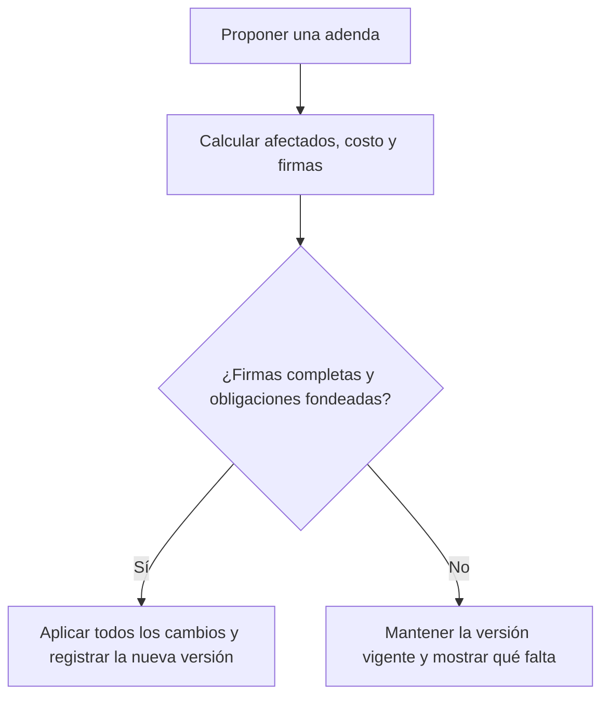

# Adenda

**Contratos vivos multiparte sobre Stellar.**

Cuando cambia el alcance de un proyecto, el cambio puede afectar a varios subcontratistas a la vez. Adenda muestra **qué compromisos cambian, cuánto cuesta el ajuste y qué firmas y fondos faltan** antes de aplicarlo.

## El núcleo

| Pieza | Qué hace |
| --- | --- |
| **Grafo de obligaciones** | Modela los compromisos como nodos y sus dependencias como aristas. Cada obligación tiene un monto, un plazo y un estado de fondeo. |
| **Adenda versionada** | Propaga el impacto por el grafo, calcula el ajuste presupuestario e identifica quiénes deben aprobar: las partes afectadas y quien aporta los fondos. |
| **Ejecución atómica** | Soroban aplica todos los cambios en una sola transacción cuando están las aprobaciones requeridas y cada obligación nueva o modificada tiene respaldo. Si falta algo, sigue vigente la versión anterior. |

## Flujo

El **tablero de fondeo** muestra qué obligaciones tienen respaldo total, parcial o pendiente. El historial conserva las versiones, quién aprobó cada cambio y con qué fondos se ejecutó.

## Qué hace Stellar

- **Soroban** mantiene el grafo, las adendas y las reglas de ejecución.
- **Trustless Work** es la integración prevista para custodiar fondos y liberar pagos.
- **Bell (CAP-84)** facilita la conciliación con direcciones multiplexadas. Los escrows y el estado del contrato llevan la separación de fondos.

**Alcance inicial:** grafo, adendas y tablero de fondeo en Stellar Testnet.
