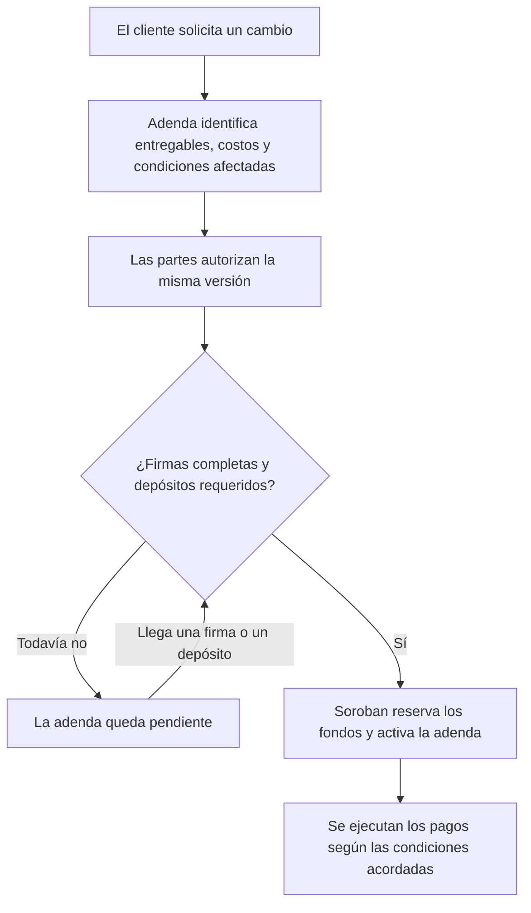

# Adenda

**Adendas multiparte con pagos programables en Stellar.**

Cuando un cliente cambia el alcance, varios subcontratistas pueden tener que rehacer entregables, comprar materiales o asumir nuevos plazos. **Adenda convierte ese cambio en una versión que las partes afectadas autorizan y fondean antes de empezar el trabajo adicional.** En esa misma versión quedan acordados el presupuesto, los hitos y las condiciones de pago.

## Cómo se activa una adenda

Firman el cliente, la empresa contratante y los proveedores cuyas condiciones cambian. Cada autorización queda vinculada al hash de esa versión. Si cambia el alcance, el importe o el plazo, las partes revisan y autorizan una versión nueva.

## Qué puede acordarse en la adenda

| Condición | Qué hace el contrato |
| --- | --- |
| **Retención de pago** | Retiene una parte del importe de un hito y la libera cuando se cumple la condición pactada, como la conformidad final. |
| **Garantía contractual** | Mantiene un depósito separado en escrow. Lo devuelve al aportante cuando se cumple la obligación o lo distribuye según la resolución de una disputa autorizada. |
| **Adelanto con destino específico** | Paga directamente al proveedor autorizado para una orden concreta, como la compra de materiales. El adelanto se descuenta del saldo del subcontrato. |

## Qué aporta Stellar

- **Soroban** comprueba las firmas y los depósitos requeridos. La activación y la reserva por obligación ocurren en la misma transacción.
- **Bell (Protocolo 30, CAP-84)** permite identificar los depósitos con una dirección multiplexada `W…` por adenda dentro de una tesorería compartida. El contrato contabiliza cada reserva por separado.
- **Trustless Work** es la integración prevista para los escrows y la liberación de pagos por hitos.
